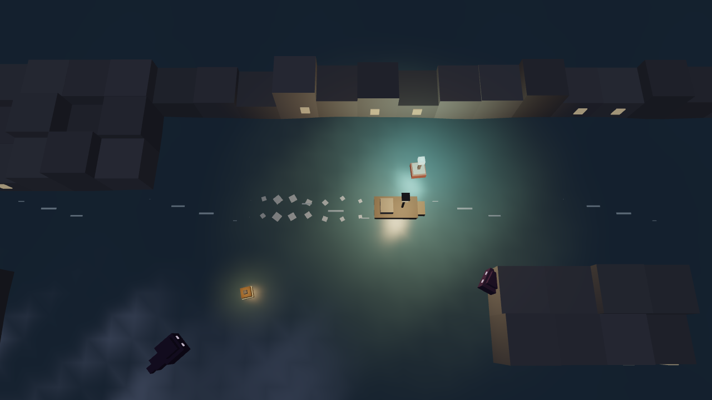

# Lantern Drift

Steer a small lantern boat through a dark, flooded town. Your light keeps shadow creatures away.
Collect oil, light the buoys, and reach the lighthouse before your lantern goes out.

Made for [Hack Club Mipmap](https://mipmap.hackclub.com/) (Tier Romeo: raw WebGL2, no engine).



## Controls
| | Keyboard | Gamepad | Touch |
|---|---|---|---|
| Steer | A / D or ← / → | Left stick or d-pad | ◀ ▶ buttons |
| Row forward / back | W / S or ↑ / ↓ | Stick up / down, or RT / LT | ▲ button |
| Flare | Space | A | ✦ button |
| Pause | P or Esc | Start | II button |
| Restart level | R | | |
| Back to title (when paused) | Q | B | |
| Settings (title or pause) | O | Y | tap "O settings" |
| Mute | M | | |
| Frame rate counter | F3 | | |

On the title screen, press a number (or click a level) to replay any level you've unlocked.

## Boatyard
Press **B** on the title screen. Clearing levels earns **Embers** ✦. You get more for later levels, oil left over, first clears, new best times and full runs. Even a lost run pays a little for every buoy you lit.
- **11 boats**, each with its own look and handling: Little Skiff, Rubber Dinghy, Canal Punt, Fishing Boat, Speedboat, Gondola, Tugboat, Paddle Steamer, Lantern Junk, Ember Racer and Moonlit Clipper.
- **Stats** change how the boat plays: top speed, acceleration, handling (turning and grip), oil tank, fuel economy and lantern radius. The stat bars show ▲/▼ compared with your equipped boat.
- **Upgrades** per boat, 3 levels each: Engine, Oil tank, Efficient burner and Lantern lens.
- **Paint** for hull and trim: 17 colours, including glow paints that shine in the dark. Buy a colour once and use it on every boat.
- The middle of the screen is a live 3D preview, drawn by the game's own renderer.

## Level editor
Press **E** on the title screen (or click "E level editor").
- Paint a 32 × 16 map: water, buildings, buoys, oil, shadows, currents, the boat start and the lighthouse (number keys pick tools, right-click erases).
- The editor checks your level is fair: closed walls, and every buoy, oil can and the lighthouse reachable by boat.
- **Play** it straight away, then come back and keep editing.
- **Share code** copies a link like `.../lantern-drift/#level=...`. Anyone who opens it gets your level in their editor.

## How to play
- Your oil drains over time, and your light shrinks as it runs low. Collect oil cans.
- Sail past every buoy to light it. Lit buoys are safe zones that shadows won't enter.
- Shadows lunge at you and steal oil. A flare knocks them back. They can't pass through buildings, so put walls between you and them.
- Once every buoy is lit, the lighthouse wakes up. Reach it to clear the level.
- Later levels have currents: water that carries your boat along. Ride them, or row hard against them.
- In Ember Bay, lit buoys burn out after 40 seconds, so plan a route that gets them all lit at once.
- Your progress and best time for each level are saved in the browser.

## Levels
1. The Flooded Market
2. Lantern Row
3. The Old Harbour
4. The Canals (currents)
5. Ember Bay (buoys burn out: light them all in time)
6. The Storm (wind gusts push the boat; lightning stuns shadows, but stay out from under it)
7. Lighthouse Point (the finale), followed by an ending with fireworks, credits and your full-run time

## Run it
Needs [Node.js](https://nodejs.org/) (no packages to install):
```
node serve.mjs
```
Then open http://localhost:5173

## Graphics techniques (Tier Romeo)
WebGL2 is only used to talk to the GPU. Everything below is written in this repo:
- **Lighting:** one hand-written GLSL shader with up to 16 point lights (lantern, flares, buoys, lighthouse, beam spot), Blinn-Phong specular, a faint moon, emissive surfaces, and Reinhard tone mapping with gamma.
- **Water:** a grid mesh displaced in the vertex shader by three sine waves, with the matching analytic normal so lights glint on the waves.
- **Planar reflections (mirrors):** each frame the scene is drawn a second time, mirrored in the water plane (a y-flip matrix before the camera) with below-water fragments clipped, into a half-resolution framebuffer. The water shader samples it in screen space, offsets it by the wave normal so it ripples, undoes the tone mapping, and blends it with a Fresnel term.
- **Textures and mipmaps** (`src/textures.js`): brick, roof tile, wood plank and stone textures are generated pixel by pixel in code (value noise, no image files) into one `TEXTURE_2D_ARRAY`, with a full mipmap chain from `generateMipmap`, trilinear filtering and 8× anisotropic filtering where supported. Surfaces are textured with triplanar mapping in object space, so the box meshes need no UV coordinates and textures stay stuck to the moving boat.
- **Post-processing** (`src/post.js`): the scene is drawn into a 4× multisampled renderbuffer, resolved with `blitFramebuffer`, then bright-passed and downsampled to quarter resolution and blurred with a separable 9-tap Gaussian (linear-sampling trick, two iterations) for bloom. A composite pass adds a vignette, film grain, a chromatic split on hits, low-oil colour grading and fade-ins. The full-screen triangle is generated from `gl_VertexID`, with no vertex buffer.
- **Instanced particles** (`src/particles.js`): up to 1500 particles in one `drawArraysInstanced` call, with per-instance attributes (`vertexAttribDivisor`), camera-facing billboards or velocity-stretched streaks, and additive blending with depth writes off.
- **Meshes:** all models are built from boxes in code (`src/meshes.js`), and each level's buildings are baked into one static vertex buffer.
- **Maths:** hand-written perspective, look-at and model matrices (`src/math.js`).
- **Fallback and auto quality:** if offscreen rendering isn't supported, the game draws straight to the screen. If frames stay slow while playing, it steps down by itself (reflections, then bloom, then resolution). Every effect can also be switched off in Settings, including a reduced-flashing mode.

## How it's made
- Plain JavaScript modules and raw WebGL2: no engine, no three.js.
- `src/gl.js`: shader compiling and vertex buffers
- `src/math.js`: hand-written matrix maths (perspective, look-at, model matrices)
- `src/shaders.js`: one GLSL shader with wavy water and up to 16 point lights
- `src/meshes.js`: low-poly models built from boxes in code
- `src/game.js`: boat physics, currents, collisions, oil, buoys and creature behaviour
- `src/render.js`: camera, drawing, the boat's foam wake and current streaks
- `src/levels.js`: the five level maps, drawn as text
- `src/main.js`: game states, HUD, saving, keyboard / gamepad / touch input, ending
- `src/editor.js`: the level editor and share links
- `src/boats.js`: the 11 boat designs, their stats, upgrades and paints
- `src/shop.js`: the Boatyard screen
- `src/post.js`: post-processing (MSAA resolve, bloom, colour grading)
- `src/particles.js`: instanced particle system
- `src/textures.js`: procedural textures in a texture array, with mipmaps
- `src/audio.js`: all sounds and the generative music, made live with the Web Audio API (no sound files)

### Dev tools
- `node --test tests/game.test.mjs` (or `npm test`) runs 16 tests: oil, pickups, flares, hits, buildings, currents, fading buoys, storm lightning, winning and losing, share codes and the level checker.
- `node tools/checklevels.mjs` checks every map: closed walls, and that every buoy, oil can and lighthouse can be reached.
- `node tools/autoplay.mjs` has two bots (a "good" one and a "sloppy" one) play every level many times
  and prints win rates, time and oil left. It was used to tune difficulty so each level is a bit harder than the last.
- Press F9 while running `node serve.mjs` to save a screenshot into `screenshots/`.
- In the browser console, `lanternDrift.step(2)` runs two seconds of game time and `lanternDrift.game` is the current level.

## How this was made (AI disclosure)
Lantern Drift was designed and written mainly by **Claude Code** (Anthropic's AI coding agent), directed by me,
for Hack Club Mipmap. Mipmap allows AI tools; its rules say AI coding time counts for less than hand-written time.
I chose the idea, the tier and the direction. The AI wrote the code, the shaders and the tools, and tested them.
Hackatime time on this project is mostly AI-assisted time.

## Progress
- [x] WebGL2 renderer, camera, wavy water, lantern and buoy lighting
- [x] Boat steering with keel-style drag and building collisions
- [x] Oil, buoys, lighthouse goal, shadow creatures, flares
- [x] Title / pause / game over / win screens, generated sound
- [x] Difficulty tuning with play-test bots
- [x] Saved progress, best times, level select
- [x] Boat wake, gamepad and touch controls
- [x] Levels 4 and 5 with currents
- [x] Bloom post-processing, instanced particles, lighthouse beam, screen shake
- [x] Generative music, settings menu, first-time tips
- [x] Procedural textures with mipmaps, planar water reflections
- [x] Published on GitHub Pages
- [x] Level 6 (Ember Bay, fading buoys), automatic quality scaling, reduced-flashing option, rule tests
- [x] The Storm (wind and lightning), ending with fireworks and credits, full-run timer
- [x] Level editor with fairness checks and share links
- [x] Phone layout: wider portrait view, touch hints, HUD that fits
- [x] Shadows collide with buildings and path around them (flow field)
- [x] Boatyard: Embers currency, 11 boats, upgrades, paints, live 3D preview
- [ ] Play-testing by real people
- [ ] Ship on Mipmap
