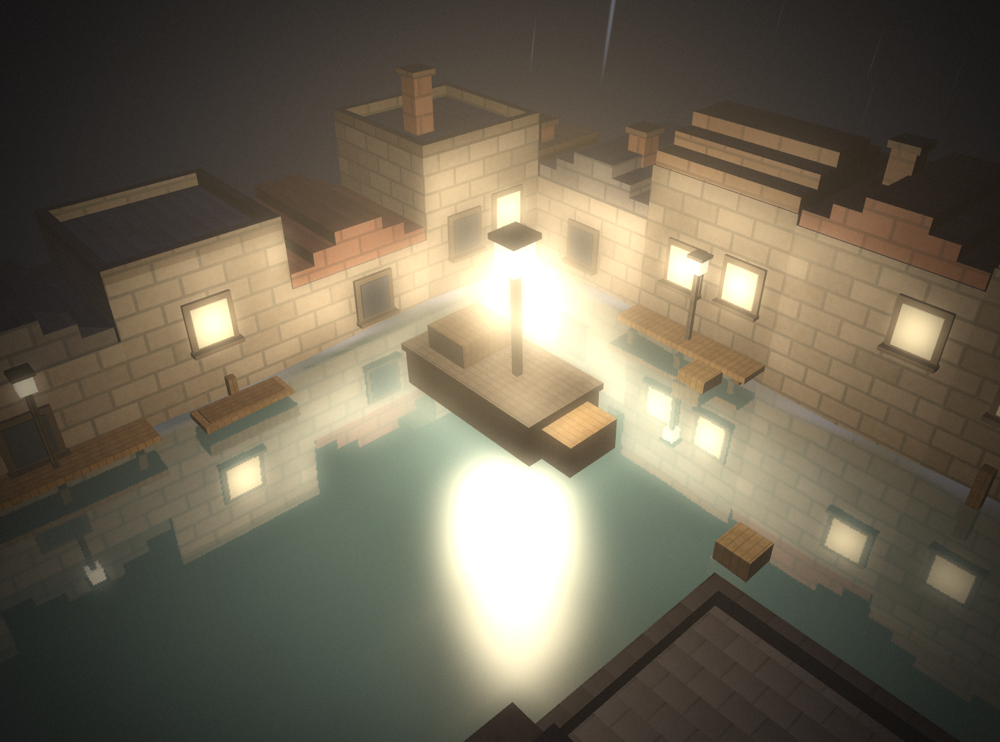
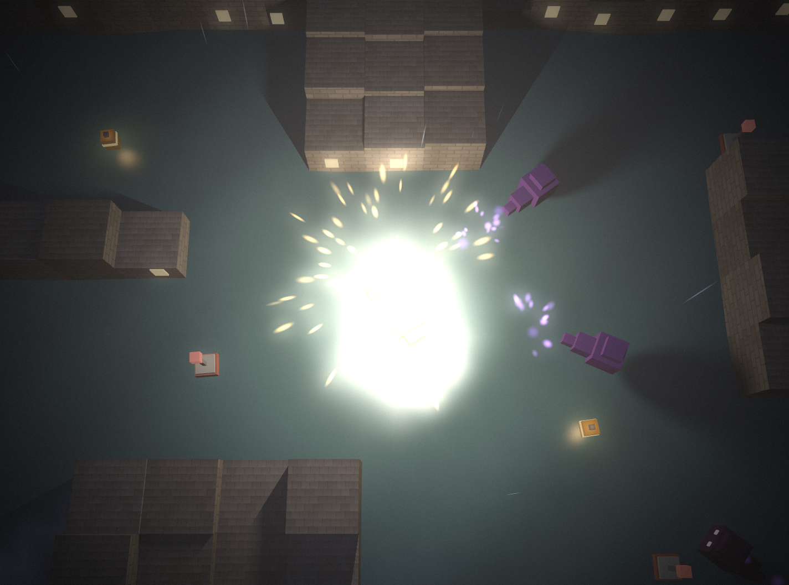

# Lantern Drift

Steer a small lantern boat through a dark, flooded town. Your light keeps shadow creatures away.
Collect oil, light the buoys, and reach the lighthouse before your lantern goes out.

Made for [Hack Club Mipmap](https://mipmap.hackclub.com/) (Tier Romeo: raw WebGL2, no engine).



## Controls
| | Keyboard | Gamepad | Touch |
|---|---|---|---|
| Steer | A / D or ← / → | Left stick or d-pad | ◀ ▶ buttons |
| Row forward / back | W / S or ↑ / ↓ | Stick up / down, or RT / LT | ▲ button |
| Flare | Space | A | ✦ button |
| Dash (a burst of speed, costs a little oil) | Shift | B or RB | » button |
| Pause | P or Esc | Start | II button |
| Restart level | R | | |
| Back to title (when paused) | Q | B | |
| Settings (title or pause) | O | Y | tap "O settings" |
| Photo mode (while playing) | C, then drag / WASD to orbit, scroll / Q E to zoom, F9 to save | | 📷 button, drag to orbit |
| Mute | M | | |
| Frame rate counter | F3 | | |

On the title screen, press a number (or click a level) to replay any level you've unlocked,
**D** for the Daily Voyage or **N** for Endless voyages.

## Daily Voyage and Endless
- **Daily Voyage:** a new generated town every day, the same for every player (the date is the seed).
  Beat it for Embers, set your best time for the day, and keep a streak going by clearing it on consecutive days.
  Press **S** on the result screen to copy a spoiler-free summary (time, oil, shards, streak) with a link, to share with friends.
- **Endless:** voyage after voyage, each further out and harder: bigger maps, more and faster shadows,
  and twists (strong currents, buoys that burn out, storms). It ends when your lantern goes out. Your best run is saved.
- Voyages are built by `src/voyages.js` from a seeded random number generator, and every map has to pass the same
  fairness check as the level editor before it's used. The play-test bots won 288 of 288 generated maps without
  getting stuck, and the sloppy bot's win rate drops from 100% on the first voyage to about 40-50% by voyage 10.

## Boatyard
Press **B** on the title screen. Clearing levels earns **Embers** ✦. You get more for later levels, oil left over, first clears, new best times and full runs. Even a lost run pays a little for every buoy you lit.
- **22 boats**, each with its own look, handling and a short description: Little Skiff, Bed Mattress, Comfy Couch, Rubber Dinghy, Canal Punt, Fishing Boat, Speedboat, Gondola, Tugboat, Paddle Steamer, Luxury Yacht, Lantern Junk, Submarine, Ember Racer, Navy Destroyer, Navy Warship, Moonlit Clipper, Old Battleship, Cruise Ship, HMHS Britannic, Aircraft Carrier and RMS Titanic.
- **Special traits** on the big ships, for example: the battleship's armour halves stolen oil, the submarine's silent running hides you from distant shadows, the carrier's spotter plane lights buoys from twice as far, the cruise ship's buffet makes oil cans give 50% more, the couch saves oil while you rest, and the Titanic... hates bumping into things.
- **Moving parts:** spinning radars and propellers (faster as you speed up), sweeping gun turrets, paddle wheels, a periscope, a patrol plane circling the carrier, and steam puffing from funnels. Each part is its own mesh, rotated about a pivot every frame (`pivotRotate` in `src/math.js`).
- **Stats** change how the boat plays: top speed, acceleration, handling (turning and grip), oil tank, fuel economy and lantern radius. The stat bars show ▲/▼ compared with your equipped boat.
- **Upgrades** per boat, 3 levels each: Engine, Oil tank, Efficient burner and Lantern lens.
- **Paint** for hull and trim: 17 colours, including glow paints that shine in the dark. Buy a colour once and use it on every boat.
- The middle of the screen is a live 3D preview, drawn by the game's own renderer.

## Achievements
25 achievements, each paying Embers, from *First Light* (light a buoy) to *Far Horizon* (reach voyage 10 in Endless):
flare skills (stun three shadows with one flare), clean runs (clear a level without losing oil to a shadow),
speed (clear The Flooded Market in under 40 seconds), storms, oil and buoy totals, the Daily Voyage streak,
the editor and the Boatyard. A toast pops up when one unlocks; press **A** on the title screen to see them all.

## Level editor
Press **E** on the title screen. Build a 32 x 16 flooded town, test it, and share it with a link.
- **Tools:** water, buildings, buoys, oil, shadows, boat start, lighthouse and four directions of current (keys 1-0 and -).
- **Brush, Box and Fill** modes (P / R / F): paint as you drag, drag out a rectangle, or flood a connected area.
- **Mirror** (M) paints both halves at once for symmetrical maps; currents flip direction on the far side.
- **Undo / redo** (Ctrl+Z / Ctrl+Y), up to 100 steps. Right-click paints water.
- **Level settings:** a name, a difficulty (Calm, Normal, Hard, Nightmare) and an optional twist (storm, or buoys that burn out).
- **🎲 Random** starts from a generated town (the same generator as the Daily Voyage), ready to remix.
- **Live checks and tips:** it tells you what's missing (a boat start, an unreachable buoy, a gap in the wall) and gives
  balance tips, such as when there's too little oil for the amount of water. **?** shows a six-step guide.
- **Play** it straight away, then come back and keep editing. Your work is saved in the browser.
- **Share link** copies a link like `.../lantern-drift/#level=...` with the map, name, difficulty and twist in it.
  Anyone who opens it gets your level in their editor. Older links still work.

## How to play
- Your oil drains over time, and your light shrinks as it runs low. Collect oil cans.
- Sail past every buoy to light it. Lit buoys are safe zones that shadows won't enter.
- Shadows lunge at you and steal oil. A flare knocks them back. They can't pass through buildings, so put walls between you and them.
- Once every buoy is lit, the lighthouse wakes up. Reach it to clear the level.
- Later levels have currents: water that carries your boat along. Ride them, or row hard against them.
- In Ember Bay, lit buoys burn out after 40 seconds, so plan a route that gets them all lit at once.
- **Whirlpools** pull in your boat and the shadows. Skim the edge for a slingshot; get caught in the middle and you're
  spat out with less oil. Lure a shadow into one and it's stunned.
- **Ember shards** are optional treasure: each one pays Embers. Every story level hides three, and voyages have more.
- Your progress and best time for each level are saved in the browser.

## Levels
1. The Flooded Market
2. Lantern Row
3. The Old Harbour
4. The Canals (currents)
5. Ember Bay (buoys burn out: light them all in time)
6. The Storm (wind gusts push the boat; lightning stuns shadows, but stay out from under it)
7. Lighthouse Point (the finale), followed by an ending with fireworks, credits and your full-run time

## Run it
Needs [Node.js](https://nodejs.org/) (no packages to install):
```
node serve.mjs
```
Then open http://localhost:5173

## Graphics techniques (Tier Romeo)



- **Ray-traced shadows:** every light casts real shadows. The level's buildings are uploaded as a small height texture
  (one texel per grid cell), and for each pixel and each light the fragment shader walks the ray to the light through
  that grid, cell by cell (a 2D DDA, Amanatides-Woo), checking the ray's height against each roof. Rays that just
  skim a roof get a soft penumbra. The shadow creatures are traced too, as soft spheres, so the lantern throws their
  shadows across the water and walls. Cheap early-outs keep it fast: lights that add almost nothing are skipped, and a
  ray stops once it climbs above the tallest roof (a test checks the meshes and the shader agree on that height).
- **Foam and ambient occlusion:** the same height grid gives each water pixel its distance to the nearest wall,
  so water lapping against buildings gets an animated foam line (which hides the reflection, like real foam), and
  water hemmed in by walls, and the bottoms of brick walls, get darker ambient light.
- **Weather:** rain (streak particles), snow (drifting flakes, snow-covered roofs and a brighter, moonlit ambient), fog
  (thick glowing mist and drifting fog banks) or a clear night. The Canals are foggy, Ember Bay is clear, Lighthouse
  Point is snowed in, voyages pick their own, and the editor has a weather setting that travels in share links.
- **Night sky** (`src/sky.js`): a full-screen pass rebuilds each pixel's view ray from the inverse view-projection
  matrix (hand-written 4x4 inverse in `src/math.js`) and draws a gradient with a warm haze over the town, twinkling
  stars, a moon with a halo and drifting fbm-noise clouds lit from behind. It's drawn mirrored in the reflection pass
  too, so the clouds and stars show in the water.
- **Volumetric light:** the rain mist glows around the lantern, flares and the lighthouse. Instead of ray-marching fog,
  the shader uses the closed-form integral of a point light's falloff along the view ray (an arctangent).
- **Resolution and frame rate:** Settings has Auto, Native, 1080p, 1440p and 4K rendering (the scene renders at that
  size and is scaled to the window, so 4K on a 1080p screen is supersampling), and frame-rate limits of 30, 60, 120,
  144, 240 or uncapped. Limits above the screen's refresh rate run a free loop on `MessageChannel`, with a GPU fence
  (`fenceSync` / `clientWaitSync`) so the CPU never queues frames faster than the GPU finishes them.
WebGL2 is only used to talk to the GPU. Everything below is written in this repo:
- **Lighting:** one hand-written GLSL shader with up to 16 point lights (lantern, flares, buoys, lighthouse, beam spot), Blinn-Phong specular, a faint moon, emissive surfaces, and Reinhard tone mapping with gamma.
- **Water:** a grid mesh displaced in the vertex shader by three sine waves, with the matching analytic normal so lights glint on the waves.
- **Planar reflections (mirrors):** each frame the scene is drawn a second time, mirrored in the water plane (a y-flip matrix before the camera) with below-water fragments clipped, into a half-resolution framebuffer. The water shader samples it in screen space, offsets it by the wave normal so it ripples, undoes the tone mapping, and blends it with a Fresnel term.
- **Textures and mipmaps** (`src/textures.js`): brick, roof tile, wood plank and stone textures are generated pixel by pixel in code (value noise, no image files) into one `TEXTURE_2D_ARRAY`, with a full mipmap chain from `generateMipmap`, trilinear filtering and 8× anisotropic filtering where supported. Surfaces are textured with triplanar mapping in object space, so the box meshes need no UV coordinates and textures stay stuck to the moving boat.
- **Post-processing** (`src/post.js`): the scene is drawn into a 4× multisampled renderbuffer, resolved with `blitFramebuffer`, then bright-passed and downsampled to quarter resolution and blurred with a separable 9-tap Gaussian (linear-sampling trick, two iterations) for bloom. A composite pass adds a vignette, film grain, a chromatic split on hits, low-oil colour grading and fade-ins. The full-screen triangle is generated from `gl_VertexID`, with no vertex buffer.
- **Instanced particles** (`src/particles.js`): up to 1500 particles in one `drawArraysInstanced` call, with per-instance attributes (`vertexAttribDivisor`), camera-facing billboards or velocity-stretched streaks, and additive blending with depth writes off.
- **Meshes:** all models are built from boxes in code (`src/meshes.js`), and each level's buildings are baked into one static vertex buffer.
- **Maths:** hand-written perspective, look-at and model matrices (`src/math.js`).
- **Fallback and auto quality:** if offscreen rendering isn't supported, the game draws straight to the screen. If frames stay slow while playing, it steps down by itself (reflections, then bloom, then resolution). Every effect can also be switched off in Settings, including a reduced-flashing mode.

## How it's made
- Plain JavaScript modules and raw WebGL2: no engine, no three.js.
- `src/gl.js`: shader compiling and vertex buffers
- `src/math.js`: hand-written matrix maths (perspective, look-at, model matrices)
- `src/shaders.js`: one GLSL shader with wavy water and up to 16 point lights
- `src/meshes.js`: low-poly models built from boxes in code
- `src/game.js`: boat physics, currents, collisions, oil, buoys and creature behaviour
- `src/render.js`: camera, drawing, the boat's foam wake and current streaks
- `src/levels.js`: the five level maps, drawn as text
- `src/main.js`: game states, HUD, saving, keyboard / gamepad / touch input, ending
- `src/editor.js`: the level editor and share links
- `src/boats.js`: boat designs, stats, traits, upgrades and paints
- `src/ships.js`: the big ships (liners, warships, carrier, submarine) and the furniture, with moving parts
- `src/shop.js`: the Boatyard screen
- `src/post.js`: post-processing (MSAA resolve, bloom, colour grading)
- `src/particles.js`: instanced particle system
- `src/textures.js`: procedural textures in a texture array, with mipmaps
- `src/audio.js`: all sounds and the generative music, made live with the Web Audio API (no sound files)

### Dev tools
- `node --test tests/game.test.mjs` (or `npm test`) runs 33 tests: oil, pickups, flares, hits, buildings, currents, fading buoys, storm lightning, winning and losing, share codes, the level checker, boat traits, generated voyages (fair at every depth, same seed same map, harder with depth, daily changes each day) the shadow tracer's roof limit, editor share links, achievements, whirlpools and ember shards.
- `node tools/checklevels.mjs` checks every map: closed walls, and that every buoy, oil can and lighthouse can be reached.
- `src/autopilot.js` is the bot that sails the title-screen demo; the play-test tool uses the same code.
- `node tools/autoplay.mjs` has two bots (a "good" one and a "sloppy" one) play every level many times
  and prints win rates, time and oil left. It was used to tune difficulty so each level is a bit harder than the last.
  `VOYAGES=1 node tools/autoplay.mjs` does the same for generated voyages at depths 0 to 11, plus a month of Daily Voyages.
- Press F9 while running `node serve.mjs` to save a screenshot into `screenshots/`.
- In the browser console, `lanternDrift.step(2)` runs two seconds of game time and `lanternDrift.game` is the current level.

## How this was made (AI disclosure)
Lantern Drift was designed and written mainly by **Claude Code** (Anthropic's AI coding agent), directed by me,
for Hack Club Mipmap. Mipmap allows AI tools; its rules say AI coding time counts for less than hand-written time.
I chose the idea, the tier and the direction. The AI wrote the code, the shaders and the tools, and tested them.
Hackatime time on this project is mostly AI-assisted time.

## Progress
- [x] WebGL2 renderer, camera, wavy water, lantern and buoy lighting
- [x] Boat steering with keel-style drag and building collisions
- [x] Oil, buoys, lighthouse goal, shadow creatures, flares
- [x] Title / pause / game over / win screens, generated sound
- [x] Difficulty tuning with play-test bots
- [x] Saved progress, best times, level select
- [x] Boat wake, gamepad and touch controls
- [x] Levels 4 and 5 with currents
- [x] Bloom post-processing, instanced particles, lighthouse beam, screen shake
- [x] Generative music, settings menu, first-time tips
- [x] Procedural textures with mipmaps, planar water reflections
- [x] Published on GitHub Pages
- [x] Level 6 (Ember Bay, fading buoys), automatic quality scaling, reduced-flashing option, rule tests
- [x] The Storm (wind and lightning), ending with fireworks and credits, full-run timer
- [x] Level editor with fairness checks and share links
- [x] Phone layout: wider portrait view, touch hints, HUD that fits
- [x] Shadows collide with buildings and path around them (flow field)
- [x] Boatyard: Embers currency, 22 boats with traits and moving parts, upgrades, paints, live 3D preview
- [x] Ray-traced shadows (grid DDA + sphere occluders), volumetric light, 1080p/1440p/4K and 30-240/uncapped frame-rate options
- [x] Daily Voyage (seeded by date, streaks) and Endless mode (procedural voyages that keep getting harder)
- [x] Weather: rain, snow, fog and clear nights
- [x] Dash (Shift / B / RB / » button)
- [x] Night sky with moon, stars and clouds (reflected in the water)
- [x] Photo mode, boat roll and pitch, squash-and-stretch shadows, look-ahead camera
- [x] Live title screen: the autopilot sails the levels behind the menu with an orbiting camera
- [x] Whirlpools and ember shards (in the editor, voyages and every story level), wall foam and ambient occlusion
- [x] Town detail (roofs, chimneys, windows, piers, moored boats, lamp posts) and 23 achievements
- [x] Level editor v2: box and fill tools, mirror, undo/redo, name/difficulty/twist in share links, random maps, guide and tips
- [ ] Play-testing by real people
- [ ] Ship on Mipmap
